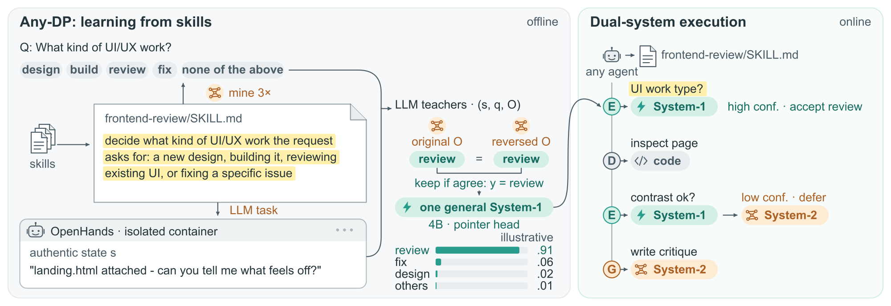
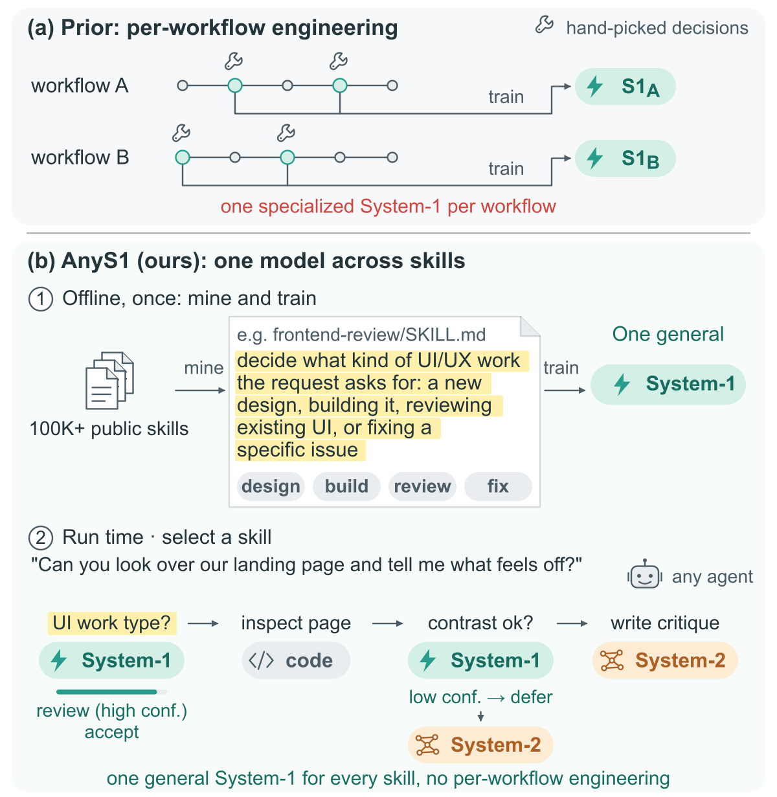
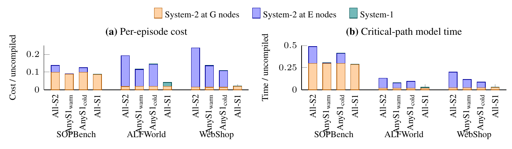

<div align="center">

<h1>Thinking Fast, Anywhere:<br>One System-1 for the Decision Points of Any Agent Workflow</h1>

<p>
  <strong>AnyS1</strong> mines grounded enumerable decision points from public procedural skills (<code>SKILL.md</code>) once,
  trains a single calibrated 4B pointer model (<strong>AnyS1-4B</strong>) on 26K container-executed states (<strong>Any-DP</strong>),
  and executes unseen workflows as a fast–slow dual system.
</p>

<p>
  <a href="https://middle-chunjie.github.io/AnyS1/">
    
  </a>
  <a href="https://huggingface.co/datasets/smSquirrel/SkillDP">
    
  </a>
  <a href="https://huggingface.co/smSquirrel/AnyS1-4B">
    
  </a>
  <a href="https://arxiv.org/abs/2611.23751">
    
  </a>
  <a href="LICENSE">
    
  </a>
</p>

<p>
  <a href="#-highlights">Highlights</a> &nbsp;·&nbsp;
  <a href="#-how-anys1-works">How It Works</a> &nbsp;·&nbsp;
  <a href="#-main-results">Main Results</a> &nbsp;·&nbsp;
  <a href="#-released-artifacts">Models &amp; Data</a> &nbsp;·&nbsp;
  <a href="#-quickstart">Quickstart</a> &nbsp;·&nbsp;
  <a href="#-citation">Citation</a>
</p>

<br>



<p>
  <sub>
    <b>Overview of AnyS1:</b> Mine D/E/G decision points across 1,072 public skills and collect container-executed teacher-consensus states (<b>Any-DP</b>) once offline; train one calibrated 4B pointer <b>System-1</b>; and gate enumerable decisions in one forward pass (<b>22–32 ms</b>) at run time.
  </sub>
</p>

</div>

> [!IMPORTANT]
> **TL;DR:** Prior dual-system agents hard-code System-1 hooks per workflow. **AnyS1** exploits the procedural structure of `SKILL.md` repositories to build **one general 4B System-1** that transfers zero-shot across unseen workflows and frontier System-2 backbones (**DeepSeek-V4.1-Flash** and **GPT-6 Sol**) — preserving `All-S2` task success while cutting episode cost by **75–91%** and critical-path model time by **63–92%** relative to an uncompiled System-2 agent under `AnyS1_warm`, and maintaining reliability with zero target data under `AnyS1_cold`.

---

## ✨ Highlights

| 🔀 64.5% E-Nodes | 🧪 83.8% Held-Out Dev | 💰 −75% to −91% Cost | ⚡ 22–32 ms S1 |
| :--- | :--- | :--- | :--- |
| `17,865` decision points mined across `1,072` public skills (`16` categories); `100%` of skills contain $\ge 1$ enumerable branch | `25,986` consensus container states (**Any-DP**); outperforms synthetic states by **+18.8 pts** and cross-task real states by **+7.0 pts** | Matches `All-S2` success under both **DeepSeek-V4.1-Flash** (`89%` avg saving vs. uncompiled agent) and **GPT-6 Sol** (`82%`), cutting model time by **63–92%** | Single H100 `bf16` forward pass (`55–81×` faster than System-2 calls; serving overhead $\kappa \le 2.1\%$) |

---

## 🧠 How AnyS1 Works

AnyS1 decomposes procedural skill instructions (`SKILL.md`) into three decision types (measured across `17,865` mined decision points from `1,072` skills):

- **`D` · Deterministic (`21.3%`)** — Surface checks (file existence, regex, numeric bounds) compiled directly into **zero-token Python predicates**.
- **`E` · Enumerable (`64.5%`)** — Bounded routing, triage, tool choice, and status checks over a closed option set, handled in one forward pass by **`AnyS1-4B`** (`Qwen3.5-4B-Base` + rank-16 LoRA + permutation-equivariant `OptionInteractionHead`) when confidence clears $p_{\max}(x) \ge \tau$, deferring to `System-2` otherwise.
- **`G` · Generative (`14.2%`)** — Open-ended synthesis and free-form code generation routed directly to `System-2`.

<div align="center">
  
</div>

| Stage | Module | Role |
| :--- | :--- | :--- |
| **1. Decision Extraction (§3.2)** | `anys1.compiler` / `anys1.mining` | Run $3\times$ independent grounded passes over `SKILL.md`, self-consistently merge E-points ($\sigma(p) \ge 2$), and synthesize 1-sentence option definitions $d(o)$. |
| **2. Self-Execution Data (§3.2)** | `anys1.mining.pipeline` | Generate verifier-checked multi-stage container tasks with 2 distractor skills, roll out OpenHands trajectories ($T \in \{0, 0.7\}$), and keep states passing forward/reverse teacher consensus (**Any-DP**, `89.2%` agreement). |
| **3. Calibrated 4B Pointer (§3.3)** | `anys1.model.train_s1` | Fine-tune `Qwen3.5-4B-Base` with rank-16 LoRA, permutation-equivariant `OptionInteractionHead` (`oc`), and label smoothing ($\epsilon = 0.1$) to keep confidence transferable across unseen skills. |
| **4. Dual-System Runtime (§3.3)** | `anys1.runtime` / `anys1.s1` | Accept `System-1` in one forward pass (`22–32 ms`) when $c(x) \ge \tau$ — either fitted on 50 unlabeled dev runs (**`AnyS1_warm`**) or transferred zero-shot at $\tau_{\text{cold}} = 0.918$ (**`AnyS1_cold`**). |

---

## 📊 Main Results

Evaluated across three benchmarks unseen during training (**SOPBench**, **ALFWorld**, **WebShop**) paired with **DeepSeek-V4.1-Flash** or **GPT-6 Sol** as `System-2`, using the **exact same `AnyS1-4B` checkpoint without retraining**:

| System-2 | Configuration | SOPBench Pass (Sav. % / Time) | ALFWorld SR (Sav. % / Time) | WebShop Score / SR (Sav. % / Time) | Avg. $\Delta$ pt | Avg. Sav. % |
| :--- | :--- | :---: | :---: | :---: | :---: | :---: |
| **DeepSeek-V4.1-Flash** | `System-2` Agent w/ Skills *(Uncompiled)* | `55.2` (– / 51.4s) | `82.8` (– / 163s) | `54.9` / `34.4` (– / 146s) | `−17.8` | reference |
| | Compiled Workflow (`All-S2`) | `83.2` (86% / 25.0s) | **`96.3`** (81% / 21.3s) | `66.9` / `38.0` (76% / 29.0s) | `–` | `81%` |
| | `Jev` as System-1† | `84.0` (87% / 23.9s) | **`96.3`** (84% / 20.5s) | `67.1` / `38.6` (83% / 17.3s) | `+0.3` | `84%` |
| | **`AnyS1_warm`** *(50 unlabeled dev runs)* | **`84.3`** (**91%** / **15.6s**) | `95.5` (**88%** / **12.9s**) | **`68.1*`** / **`38.8`** (86% / 17.1s) | **`+0.5`** | **`89%`** |
| | **`AnyS1_cold`** *(transferred τ = 0.918, 0 runs)* | `83.2` (87% / 21.2s) | `95.5` (85% / 15.7s) | `67.9` / `38.0` (**89%** / **12.7s**) | `+0.1` | `87%` |
| **GPT-6 Sol** | `System-2` Agent w/ Skills *(Uncompiled)* | `61.2` (– / 207.6s) | `88.8` (– / 413.5s) | `48.5` / `33.6` (– / 317.3s) | `−16.8` | reference |
| | Compiled Workflow (`All-S2`) | `82.1` (86% / 124s) | **`96.3`** (56% / 193s) | **`70.6`** / **`41.8`** (72% / 81.4s) | `–` | `71%` |
| | **`AnyS1_warm`** *(50 Sol dev episodes)* | **`82.5`** (**91%** / **75.8s**) | `95.5` (**75%** / **101s**) | `70.4` / `40.0` (80% / 49.4s) | `−0.2` | **`82%`** |
| | **`AnyS1_cold`** *(unchanged τ = 0.918)* | **`82.5`** (88% / 107s) | `94.0` (69% / 134s) | `70.1` / `40.4` (**86%** / **33.3s**) | `−0.8` | `81%` |

*Sav. %: episode cost saving relative to the uncompiled `System-2` agent with skills under the same System-2; Time: critical-path model-call seconds per episode; Avg. Δ pt: macro-mean primary-metric difference from `All-S2`.*

<div align="center">
  
</div>

- **Why Both Gate & Label Smoothing Matter:** Without confidence deferral (`All-S1`), ALFWorld collapses from `96.3% → 40.3%` on open-world search nodes; without label smoothing ($\epsilon = 0.1$), plain cross-entropy saturates probabilities ($\tau: 0.904 \to 0.998$) and drops ALFWorld delegation agreement from `98.4% → 83.0%`.
- **Structural Cost Ceiling:** Relative to an uncompiled System-2 agent, the compiled `All-S2` already saves `56–86%` of episode cost (`+18` avg pts); `AnyS1_warm` raises the saving to **75–91%** with `AnyS1` serving priced at L4 GPU cost (`$0.0045` per 1K decisions, $\kappa \le 2.1\%$).

---

## 📦 Released Artifacts

| Artifact | Type | Scale &amp; Details | Link |
| :--- | :--- | :--- | :--- |
| **Any-DP** | Container-Executed Decision Dataset | `1,072` public skills · `17,865` decision points · `25,986` consensus states (`89.2%` teacher agreement) | [🤗 `smSquirrel/SkillDP`](https://huggingface.co/datasets/smSquirrel/SkillDP) |
| **AnyS1-4B** | Calibrated 4B Pointer Model | `Qwen3.5-4B-Base` + LoRA (`r=16`) + `OptionInteractionHead` (`oc`), trained with label smoothing $\epsilon=0.1$ | [🤗 `smSquirrel/AnyS1-4B`](https://huggingface.co/smSquirrel/AnyS1-4B) |

---

## 🚀 Quickstart: Compile Any `SKILL.md` into Dual-System Form

### 1. Installation

```bash
git clone https://github.com/middle-chunjie/AnyS1.git
cd AnyS1
pip install -e .
# Optional: install PyTorch / Transformers / PEFT for local AnyS1-4B serving & training
pip install -e ".[train]"
```

### 2. Serve `AnyS1-4B` Locally

Download the **`AnyS1-4B`** checkpoint (`adapter_model.safetensors` + `head.pt`) from Hugging Face and launch the lightweight HTTP pointer server:

```bash
python -m anys1.model.serve_s1 \
  --checkpoint smSquirrel/AnyS1-4B \
  --host 127.0.0.1 \
  --port 8895 \
  --device cuda \
  --dtype bf16
```

### 3. Compile Your Own `SKILL.md`

Point `anys1 compile` at any procedural `SKILL.md`:

```bash
# Uses 3x grounded System-2 extraction + self-consistent merging (requires OPENAI_API_KEY)
anys1 compile examples/code_review_skill/SKILL.md -o examples/code_review_skill/compiled

# Or run offline with the deterministic markdown structural parser (zero API calls):
anys1 compile examples/code_review_skill/SKILL.md -o examples/code_review_skill/compiled --offline
```

`anys1 compile` generates **three ready-to-use artifacts** inside the output folder:

1. **`decisions.json`** — Structured specification of all extracted `D`, `E`, and `G` decision points, candidate options, and default cold-start threshold ($\tau_{\text{cold}} = 0.918$).
2. **`SKILL.anys1.md` (Mode A — Drop-In Agent Skill + MCP Hook)** — Annotated `SKILL.md` for coding agents (**Claude Code**, **OpenHands**, **Cursor**, **Codex**). At every `E` decision point, `SKILL.anys1.md` instructs the agent to call `anys1_decide` first:
   ```bash
   # Attach as an MCP stdio server in Claude Code / Cursor / OpenHands:
   anys1 mcp --compiled examples/code_review_skill/compiled --s1-url http://127.0.0.1:8895/decide
   ```
   When $p_{\max} \ge \tau$, `anys1_decide` returns `ACCEPTED_SYSTEM1` in one forward pass; when $p_{\max} < \tau$, it returns `DEFER_TO_SYSTEM2` so the host agent deliberates only on hard states.
3. **`workflow.py` (Mode B — Programmable Python SDK)** — A clean `CompiledSkillWorkflow` class wired into `DualSystemRuntime`:
   ```python
   from examples.code_review_skill.compiled.workflow import CompiledSkillWorkflow

   wf = CompiledSkillWorkflow(tau=0.918, mode="anys1")
   choice = wf.step(
       "dp_02",
       state="Modified files: auth/jwt_session.py (+42 -11). Added bearer token expiry check.",
   )
   print("Chosen branch:", choice)
   print("Execution summary:", wf.runtime.summary())
   ```

### 4. One-Command Warm Calibration (`AnyS1_cold` $\rightarrow$ `AnyS1_warm`)

> [!TIP]
> Start immediately in cold-start mode ($\tau_{\text{cold}} = 0.918$), or log ~50 unlabeled shadow runs (`mode="shadow"`, zero human labels) and fit a workflow-specific $\tau_{\text{warm}}$ targeting $\ge 95\%$ System-2 agreement:

```bash
anys1 calibrate --shadow shadow.jsonl --target-agr 0.95 -o calibration_warm.json
```

---

## 🛠️ Architecture & Reproducibility

<details>
<summary><strong>🗂️ Repository Structure</strong></summary>

```text
AnyS1/
├── anys1/
│   ├── cli.py                # Unified CLI: `anys1 compile`, `anys1 calibrate`, `anys1 decide`, `anys1 mcp`
│   ├── compiler.py           # Compiles SKILL.md -> decisions.json + SKILL.anys1.md + workflow.py
│   ├── runtime.py            # DualSystemRuntime (D/E/G dispatch, cold/warm gating, shadow logging)
│   ├── s1.py                 # System1Client & CalibratedGate (tau_cold=0.918, fit_from_shadow)
│   ├── llm.py                # OpenAI-compatible System-2 wrapper
│   ├── mcp_bridge.py         # JSON-RPC 2.0 stdio MCP tool server (`anys1_decide`)
│   ├── mining/               # Offline Any-DP data synthesis pipeline (§3.2)
│   │   └── pipeline.py       # 3x extraction, container task synthesis, trajectory locator, 2x consensus
│   └── model/                # System-1 architecture, training & serving (§3.3)
│       ├── head.py           # PointerHead & OptionInteractionHead (permutation-equivariant `oc` head)
│       ├── train_s1.py       # Qwen3.5-4B-Base + LoRA (r=16) + OptionInteractionHead + label smoothing 0.1
│       └── serve_s1.py       # Fast HTTP pointer server (/decide, /v1/models)
├── assets/                   # README figures (fig_framework.png, fig_motivation.png, fig_cost.png)
└── examples/
    └── code_review_skill/    # Self-contained SKILL.md compilation & dual-system execution example
```

</details>

<details>
<summary><strong>🏋️ Training <code>AnyS1-4B</code> on <code>Any-DP</code></strong></summary>

To reproduce `AnyS1-4B` from `Qwen/Qwen3.5-4B-Base` on the **Any-DP** dataset (`train_x3.jsonl`, `77,958` permutation-expanded instances across `25,986` consensus states from `1,072` skills):

```bash
python -m anys1.model.train_s1 \
  --data /path/to/Any-DP/train_x3.jsonl \
  --base Qwen/Qwen3.5-4B-Base \
  --head_type oc \
  --lora 16 \
  --lr 1e-4 \
  --epochs 1 \
  --batch 4 \
  --accum 2 \
  --max_state 7552 \
  --label_smoothing 0.1 \
  --dtype bf16 \
  --out ./checkpoints/AnyS1-4B
```

</details>

---

## 📝 Citation

If you find **AnyS1** or **Any-DP** useful in your research, please cite:

```bibtex
@misc{li2026anys1,
  title         = {Thinking Fast, Anywhere: One System-1 for the Decision Points of Any Agent Workflow},
  author        = {Rui Li and Liyang He and Zheng Zhang and Zhenya Huang and Qi Liu},
  year          = {2026},
  eprint        = {2611.23751},
  archivePrefix = {arXiv},
  primaryClass  = {cs.CL},
  url           = {https://arxiv.org/abs/2611.23751}
}
```

## 📄 License

This project is released under the [Apache-2.0 License](LICENSE).
